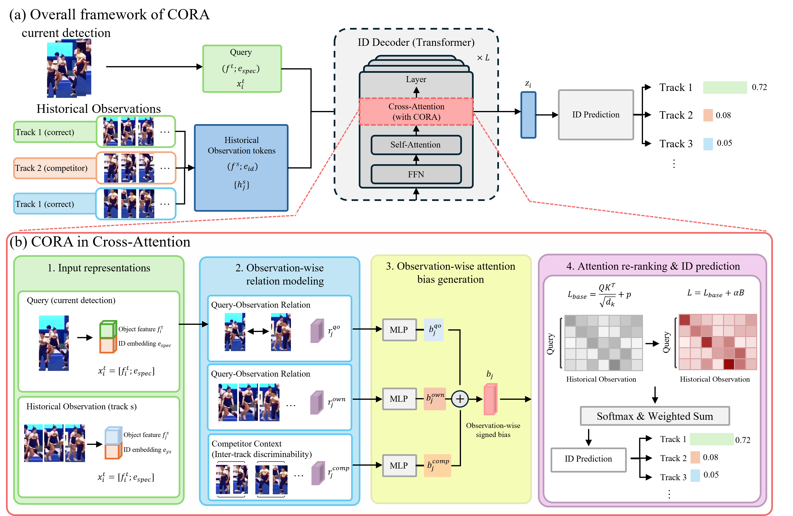

<h1 align="center">BCPR</h1>

<p align="center">
  <b>Observation-wise relational attention refinement for identity association</b>
</p>

<p align="center">
  BCPR evaluates how useful each historical observation is for the current query
  and injects a learned, signed bias into the identity decoder's cross-attention.
</p>

<p align="center">
  
</p>

<p align="center"><i>BCPR architecture and observation-wise attention-bias generation.</i></p>

## Overview

Identity association becomes difficult when historical observations are affected by
occlusion, appearance changes, or visually similar competitors. Treating every stored
observation equally can propagate ambiguous evidence into the current prediction.

BCPR addresses this problem by estimating an observation-wise relational bias for every
current-query/history pair. The model jointly considers:

- **Query–history correspondence:** whether a historical observation matches the current
  detection;
- **Own-track consistency:** whether the observation remains consistent with its causal
  track history;
- **Competitor context:** whether the observation is discriminative against other active
  identities;
- **Temporal and validity information:** how old the observation is and whether it is
  visible to the current query.

The resulting scalar bias is row-centered over valid historical observations and added
directly to the cross-attention logits:

```text
L_base = QK^T / sqrt(d_k) + mask
L_BCPR = L_base + alpha * B
```

Positive values promote useful observations, while negative values suppress ambiguous
or competitor-like evidence. Padding and causal masks always remain authoritative.

## Method highlights

- **Observation-wise refinement:** generates one signed bias per query/history pair
  instead of reducing a track to a single pooled feature.
- **Query-conditioned competitor reading:** summarizes competing tracks in a learned
  projection space with `O(Q*K*d)` relational computation.
- **Length-neutral competitor threat:** uses log-mean-exp aggregation so duplicated or
  longer histories do not receive larger weight merely because they contain more
  observations.
- **Causal own-track consistency:** constructs track statistics only from observations
  visible at the query time.
- **Stable attention injection:** applies bounded `tanh` bias and valid-key row centering
  without weakening the original masks.
- **Exact no-op initialization:** the final bias layer is zero-initialized, so enabling
  BCPR initially preserves the base decoder output.
- **Matched dual-path training:** OFF and ON endpoints share the same query, history,
  targets, candidate columns, and decoder parameters.

## Dual-path identity objective

BCPR is trained with matched OFF/ON association endpoints:

```text
OFF: alpha = 0                  -> base identity association
ON : alpha = BCPR_ON_ALPHA     -> base association + BCPR bias

L_ID = w_off * L_OFF + w_on * L_ON
```

The provided configs use `w_off = 0.5`, `w_on = 0.5`, and training alpha `1.0`.
Inference alpha is independent and can be selected with `--bcpr-alpha`.

## Reproduced BFT result

The verified BFT run uses epoch 21 and inference alpha `0.75`:

| HOTA | DetA | AssA | MOTA | IDF1 |
|---:|---:|---:|---:|---:|
| **71.174** | 69.772 | **72.841** | 77.125 | **83.059** |

The trained checkpoint is not redistributed in this source repository. Its provenance
and strict-load audit are recorded in [the release manifest](./docs/RELEASE_MANIFEST.md).

## Installation

Create the tracking environment and compile the multi-scale deformable-attention
operator by following [docs/INSTALL.md](./docs/INSTALL.md). Prepare DanceTrack or BFT
using [docs/DATASET.md](./docs/DATASET.md), then place the detector initialization files
under `pretrains/` as described in [docs/BCPR.md](./docs/BCPR.md).

Expected local paths:

```text
datasets/
├── DanceTrack/
└── BFT/

pretrains/
├── r50_deformable_detr_coco_dancetrack.pth
└── r50_deformable_detr_coco_bft.pth
```

Datasets, detector weights, trained checkpoints, and experiment outputs are excluded
from Git.

## Training

Run commands from the repository root.

### BFT

```bash
CUDA_VISIBLE_DEVICES=0,1 accelerate launch --num_processes 2 train.py \
  --config-path configs/bcpr_bft.yaml
```

### DanceTrack

```bash
CUDA_VISIBLE_DEVICES=0,1 accelerate launch --num_processes 2 train.py \
  --config-path configs/bcpr_dancetrack.yaml
```

Equivalent wrappers are available as `scripts/train_bft.sh` and
`scripts/train_dancetrack.sh`.

## Evaluation

### BFT test at alpha 0.75

```bash
CUDA_VISIBLE_DEVICES=0 python submit_and_evaluate.py \
  --config-path configs/bcpr_bft_eval.yaml \
  --inference-model outputs/bcpr_bft_seed42/checkpoint_21.pth \
  --bcpr-alpha 0.75
```

### OFF/ON comparison

```bash
# BCPR OFF
CUDA_VISIBLE_DEVICES=0 python submit_and_evaluate.py \
  --config-path configs/bcpr_bft_eval.yaml \
  --inference-model outputs/bcpr_bft_seed42/checkpoint_21.pth \
  --bcpr-alpha 0.0 --inference-group bcpr_off

# BCPR ON
CUDA_VISIBLE_DEVICES=0 python submit_and_evaluate.py \
  --config-path configs/bcpr_bft_eval.yaml \
  --inference-model outputs/bcpr_bft_seed42/checkpoint_21.pth \
  --bcpr-alpha 0.75 --inference-group bcpr_on_alpha075
```

The evaluation wrappers accept a checkpoint and optional alpha:

```bash
scripts/eval_bft.sh CHECKPOINT 0.75
scripts/eval_dancetrack.sh CHECKPOINT 0.75
```

## Monitoring and regression tests

```bash
tail -F outputs/bcpr_bft_seed42/train/log.txt \
  | grep --line-buffered -E '\[Metrics\]|bcpr/'
```

```bash
CUDA_VISIBLE_DEVICES='' python -m pytest -q \
  tests/test_bcpr_core.py tests/test_bcpr_decoder.py
```

The regression suite checks no-op initialization, masking, row centering, causal
behavior, gradient flow, and decoder injection. Validate a complete local setup before
a long run with:

```bash
CUDA_VISIBLE_DEVICES='' python tools/check_bcpr_setup.py \
  --config-path configs/bcpr_bft.yaml
```

## Repository structure

| Path | Description |
|---|---|
| `models/motip/bcpr.py` | Public BCPR module with causal consistency and length-neutral threat |
| `models/motip/bcpr_base.py` | Shared relational projection and bias-generation implementation |
| `models/motip/id_decoder.py` | Cross-attention bias injection |
| `models/motip/trajectory_modeling.py` | Raw query/history feature routing |
| `train.py` | Matched OFF/ON dual-path identity objective |
| `configs/bcpr_*.yaml` | BFT and DanceTrack train/evaluation settings |
| `scripts/` | Reproducible training and evaluation wrappers |
| `tests/` | CPU regression tests |
| `tools/check_bcpr_setup.py` | Dataset, config, model, and checkpoint preflight audit |

For detailed dataset layout, checkpoint migration, resume behavior, and complete
commands, see [docs/BCPR.md](./docs/BCPR.md).

## Checkpoint compatibility

BCPR checkpoints use the `id_decoder.bcpr.*` state namespace. The loader includes an
automatic migration path for checkpoints produced before the public BCPR naming cleanup.
Fresh training configs do not auto-resume and load only the dataset-specific detector
initialization unless an explicit resume checkpoint is supplied.

## Scope

This repository contains the BCPR method and its complete training/inference path.
Later experimental association modules are intentionally excluded so the public code,
software-registration artifact, and documented results refer to one consistent method.

## Acknowledgements and license

BCPR is implemented on the identity-prediction tracking framework from
[MCG-NJU/MOTIP](https://github.com/MCG-NJU/MOTIP). The tracking foundation also uses
[Deformable DETR](https://github.com/fundamentalvision/Deformable-DETR),
[MOTR](https://github.com/megvii-research/MOTR), and
[TrackEval](https://github.com/JonathonLuiten/TrackEval).

The upstream license remains applicable. See [LICENSE](./LICENSE) and
[NOTICE](./NOTICE) for attribution and redistribution details.
